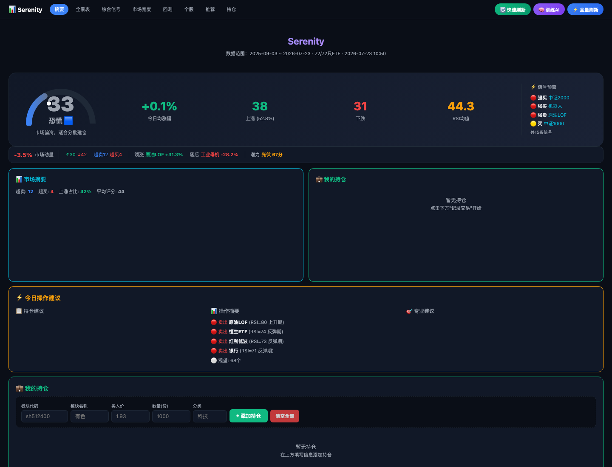

# Serenity · A股板块轮动分析仪

一个本地运行的 A 股板块轮动工作台：覆盖 72 只行业/主题/宽基 ETF，做多因子打分、周期识别、LSTM 动量预测、策略回测和组合跟踪，前端是单页 PWA，另带 macOS 原生窗口与 Android WebView 壳。



## 功能

- **全量表**：72 只 ETF 的日涨跌、5/20/60 日动量、RSI、MA20 偏离、相对强度、成交量变化，按热度打分排序
- **综合信号**：动量 + RSI + 布林带 + 回撤 + 相对强度多因子加权，输出强买/强卖分级预警
- **市场宽度**：涨跌家数、超买超卖比、平均评分、市场温度（0–100 恐慌/贪婪刻度）
- **周期识别**：Hilbert 变换 + 去趋势 FFT 双路验证，给出各板块当前所处的轮动阶段
- **回测**：动量轮动、RSI 反转、均线交叉、多因子组合、低估反转 5 类策略共 8 组参数，输出净值、年化、最大回撤
- **LSTM 预测**（可选）：多层 LSTM + Attention 预测未来 5 日动量与轮动阶段，输出 Top Picks / 规避名单
- **组合跟踪**：手动记录买卖，实时算持仓市值与盈亏
- **多端**：浏览器 / PWA 安装 / macOS 原生窗口（pywebview）/ Android WebView
- **离线快照**：仓库内置一份数据快照，clone 后不联网也能先把界面跑起来

## 快速开始

```bash
git clone <this-repo>
cd serenity-sector-rotation

python3 -m venv .venv && source .venv/bin/activate
pip install -r requirements.txt

python3 server.py            # 默认 8080
# 打开 http://localhost:8080
```

首次启动会自动做一次快速刷新（拉行情、算指标），耗时约 10 秒。不想刷新可以：

```bash
python3 server.py --no-refresh --no-auto-refresh
```

### 常用命令

| 目的 | 命令 |
|---|---|
| 只更新行情与指标 | `python3 data_engine.py` |
| 重跑回测 | `python3 run_backtest.py` |
| 重算周期 | `python3 compute_cycles.py` |
| 训练并预测 | `python3 train_and_predict.py`（需 torch） |
| 合并各步结果 | `python3 merge_all.py` |
| macOS 原生窗口 | `python3 mac_app.py` 或双击 `start.command` |

### 平台说明

- **macOS**：`mac_app.py` 用 pywebview 开原生窗口，`start.command` 会自动检查并安装 pywebview
- **Windows / Linux**：直接用 `server.py` + 浏览器
- **Android**：用 Android Studio 打开 `android_app/`，把 App 里的服务器地址改成 Mac/PC 的局域网 IP（默认 `http://10.0.2.2:8080` 是模拟器地址）

## 数据来源

行情来自腾讯财经（`web.sqt.gtimg.cn` / `web.ifzq.gtimg.cn`）与东方财富（`push2.eastmoney.com`）的公开接口，只在本地 `etf_cache/` 做 JSON 缓存，不上传任何数据。缓存有效期：交易时段 5 分钟，非交易时段 2 小时。

## 项目结构

```
├── server.py                HTTP 服务 + /api 路由 + 刷新调度（标准库实现）
├── data_engine.py           行情抓取、指标计算、缓存与回退 → analysis_data.json
├── cycle_engine.py          周期识别（Hilbert + FFT）→ cycle_analysis.json
├── dl_engine.py             LSTM + Attention 模型定义、训练、推理
├── train_and_predict.py     训练入口 → models/ + dl_predictions.json
├── backtest_engine.py       5 类策略回测框架
├── stock_backtest.py        单标的回测与参数扫描
├── run_backtest.py          回测入口 → backtest_results.json
├── recommend_engine.py      推荐打分
├── dashboard_engine.py      市场温度、阶段分布、跨市场对照 → dashboard.json
├── professional_suggestions.py  持仓层面的操作建议
├── portfolio_tracker.py     组合记账与盈亏
├── merge_all.py             合并各步产出
├── etf_config.py            ETF 池与板块分类
├── index.html               单页前端（Chart.js 本地打包）
├── sw.js / manifest.json    PWA
├── mac_app.py               macOS 窗口 + 内置服务
├── native_app.py            原生菜单栏版本
├── api_server.py            精简 API 服务
└── android_app/             Android WebView 壳（Java）
```

更细的模块职责与数据流见 [docs/ARCHITECTURE.md](docs/ARCHITECTURE.md)。

## 已知限制

- 数据接口是第三方公开接口，字段和可用性随时可能变；抓取失败时自动回退到本地缓存
- LSTM 模型是用历史数据训练的，样本量有限，预测结果不具备样本外稳定性保证
- 回测未计交易成本、滑点和冲击成本，结果偏乐观
- 仓库自带的数据快照是某一时点的静态数据，只用于预览界面

## 免责声明

本项目仅用于技术研究与学习交流，**不构成任何投资建议**。据此操作，风险自负。行情数据版权归原提供方所有，请遵守其服务条款，不要用于商业用途或高频抓取。

## License

MIT，见 [LICENSE](LICENSE)。`chart.min.js` 为 Chart.js 的发行版，遵循其 MIT 许可。
